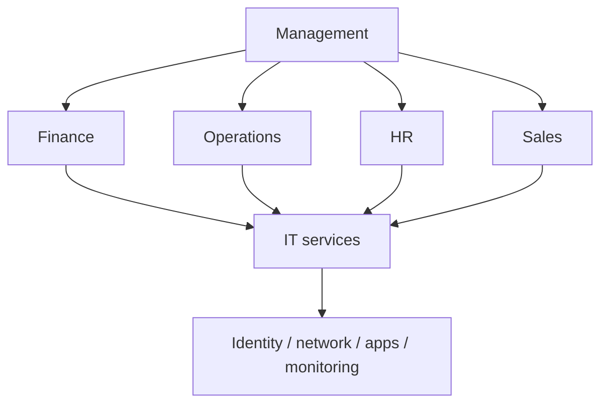

# Enterprise Lab 01

Fictional logistics company: 150 synthetic employees (finance 25, operations 100, HR and sales 25 combined), four departments, illustrative annual IT budget $60,000. Not real employment or personal spending authorization.

Progress from help desk to administration, migration, automation and executive optimization. Simulate CFO, CTO, users and security reviewer. Use synthetic data, define RTO/RPO, budget, access and acceptance criteria per scenario. Start locally; explicit spending approval before paid resources, alerts and verified cleanup. Alerts are not hard caps.
