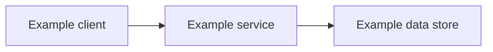

# Architecture diagram template

- Project / lab ID:
- Date / version:
- Status: Planned / Deployed / Illustrative
- Scope and assumptions:
- Trust boundaries, network ranges (sanitized), data flows and protocols:
- Identity, security controls and monitoring:
- Validation and limitations:

Replace illustrative nodes with actual components. Keep source editable; include a sanitized PNG/SVG or draw.io source when useful. Distinguish proposed from deployed architecture.
